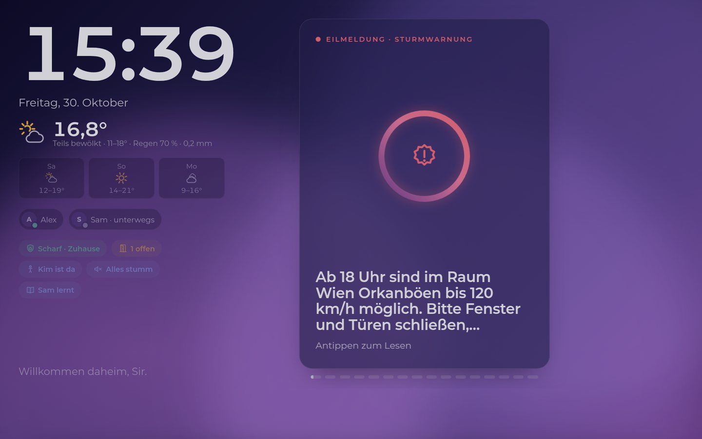
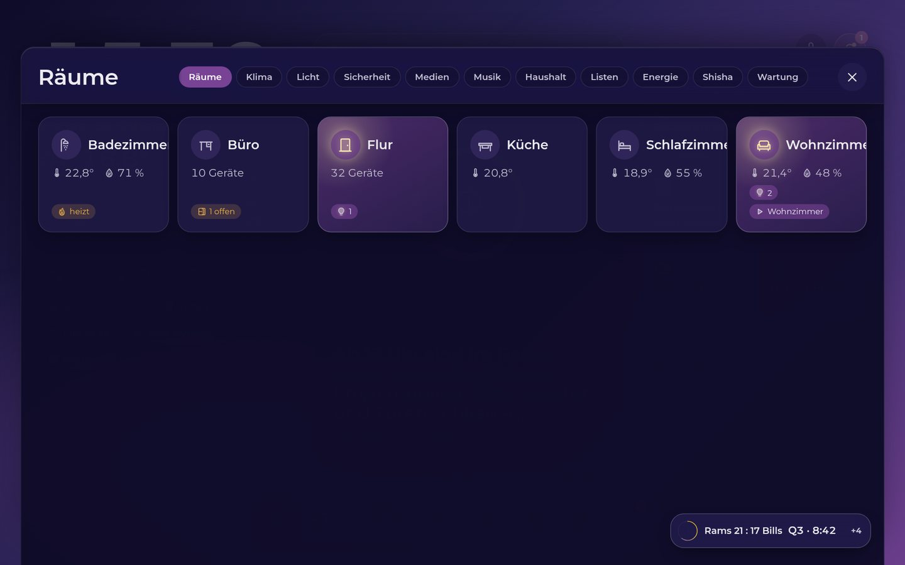
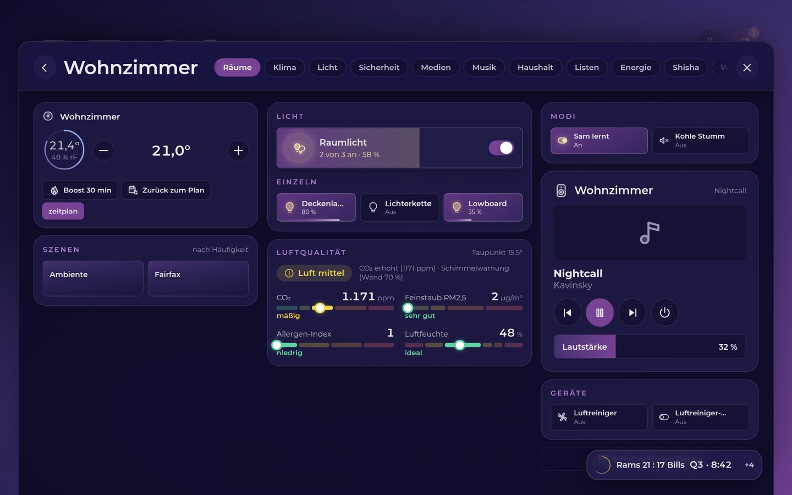
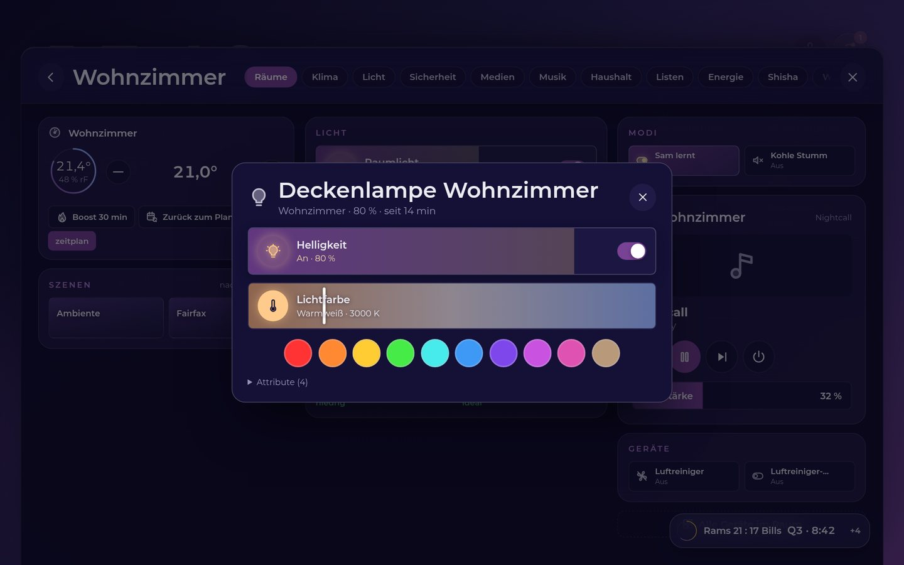
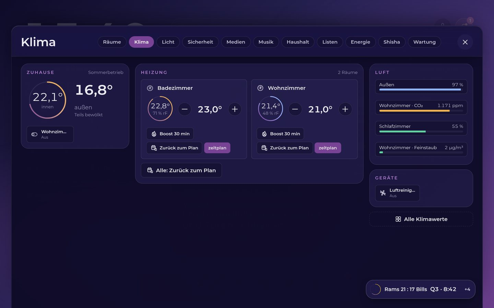
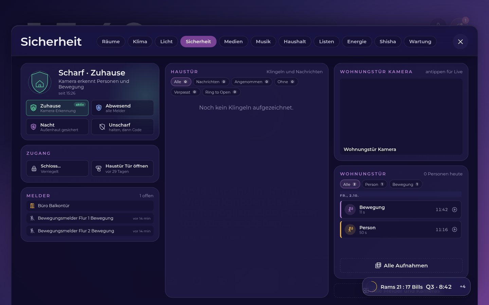
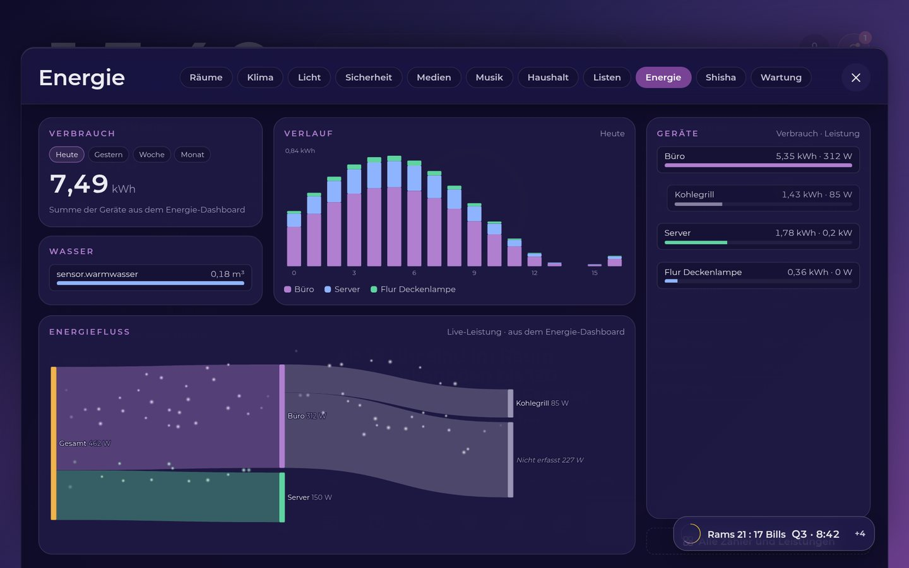
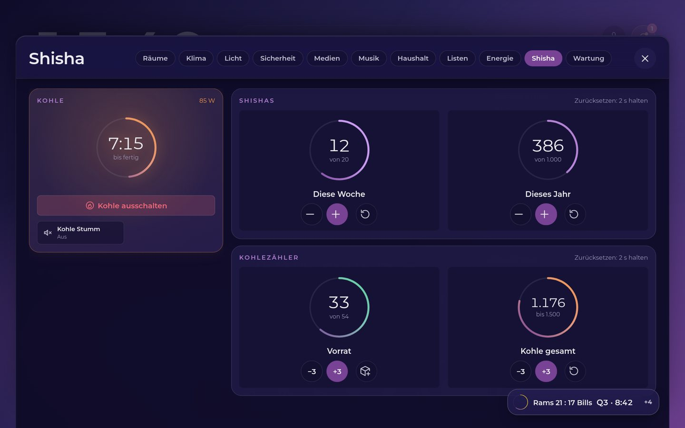
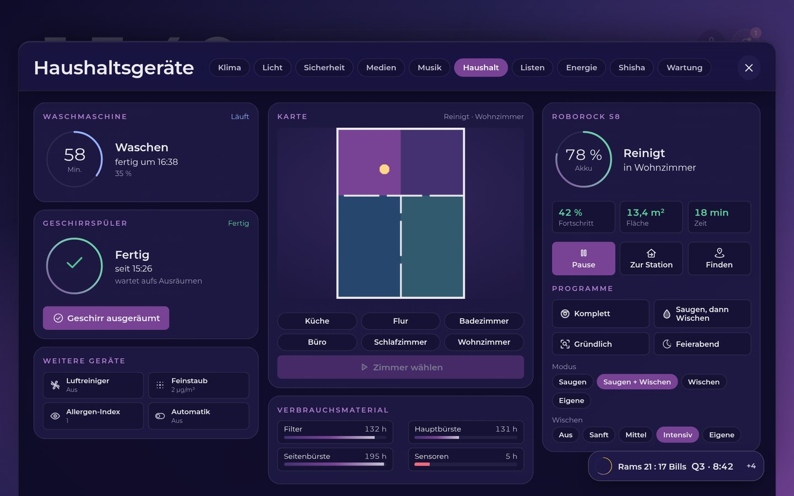
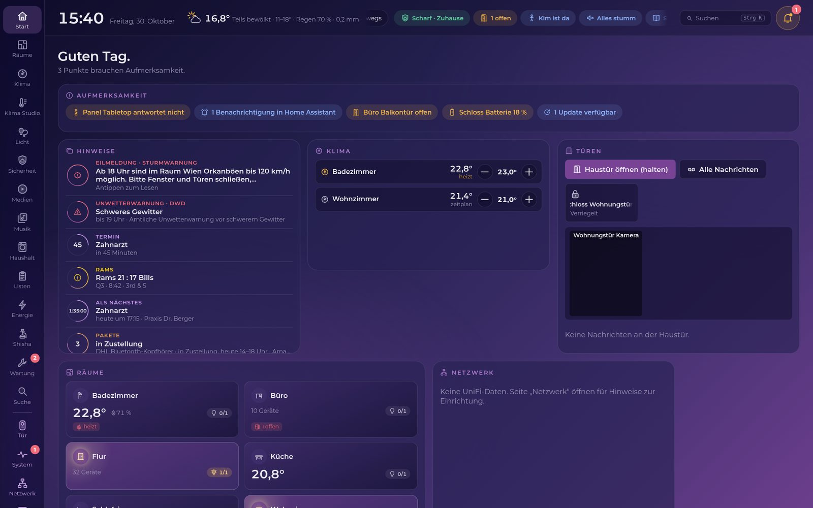

# PM Panel Studio

> © 2026 PM Networks. Alle Rechte vorbehalten. Proprietäre Software, siehe [`LICENSE`](LICENSE).
> Hinweise für KI-Assistenten: [`AGENTS.md`](AGENTS.md). Dieses Repository enthält keinen Quellcode, nur die
> Beschreibung der App für den App-Store von Home Assistant. Die App selbst wird als fertiges Abbild geladen.

Wandpanel-Oberfläche für Home Assistant: rotierende Hinweiskarten mit Ringtimern, Räume mit Licht, Klima und Medien,
Sicherheit mit Kamera und Türsprechstelle, Energie, Haushalt und eine Admin-Ansicht für den PC.

## Installation

1. Home Assistant → Einstellungen → Apps → App-Store → ⋮ → Repositories → `https://github.com/D0GC/pm-networks-ultimate-dashboard`
2. „PM Panel Studio“ installieren und starten, Optionen prüfen.
3. In der Seitenleiste „PM Dashboard“ öffnen.

## Funktionen

**Wandpanel (Flur)** – für Touch im Querformat, hell am Tag, ruhig in der Nacht:

- Startseite mit Uhr, Wetter, Personen, Statuspillen und rotierenden Hinweiskarten mit Ringtimern
  (Unwetter, Termine, Pakete, Kohle, Waschmaschine, Sport …), Ruhe- und Wachzustand per Bewegungsmelder.
- Räume mit Raumlicht-Karte (Wischen dimmt), Lichtfarbe, Klima, Luftqualität, Szenen, Medien und Geräten.
- Module für Klima, Licht, Sicherheit (Alarmanlage, Kamera, Klingelbuch), Medien und Music Assistant, Haushalt
  (Saugroboter, Waschmaschine, Spüler), Listen, Energie mit Energiefluss, Shisha und Wartung.
- Türsprechstelle: Klingel-Popup mit Kamera, Sprechen über die Gegensprechanlage, Anrufbeantworter und optional
  ein KI-Pförtner mit Live-Mitschrift.
- Sprachassistent mit eigener Aussprache-Korrektur, eigener Symbolsatz und Zahlenwalzen im Sekundentakt.

**Admin-Ansicht (PC, Seitenleiste „PM Dashboard“)** – derselbe Funktionsumfang für den großen Bildschirm, dazu
Verwaltung:

- Startseite mit „Aufmerksamkeit“ (Batterien, nicht erreichbare Panels, Updates, offene Fenster), Hinweisen, Klima,
  Türen mit Kamera, Räumen und Netzwerk; Blöcke frei anordnen.
- Alle Module des Panels als eigene Seiten, dazu Klima Studio und eine Suche über alle Entitäten (Strg K).
- System: Zustand von Home Assistant, Entitäten und Geräte, Automationen nach Kategorien, Batterien und Wartung.
- Netzwerk und Server: UniFi-Clients und -Geräte, Internet und Speedtest, HA-Host, Proxmox-Gäste.
- Dateimanager (nur Administratoren), Editor für die Panel-Einstellungen und die Flur-Startseite.

## Ansichten

Die Bilder zeigen Testdaten; Namen und Orte sind erfunden.

| | |
|---|---|
|  |  |
|  |  |
|  |  |
|  |  |
|  |  |
